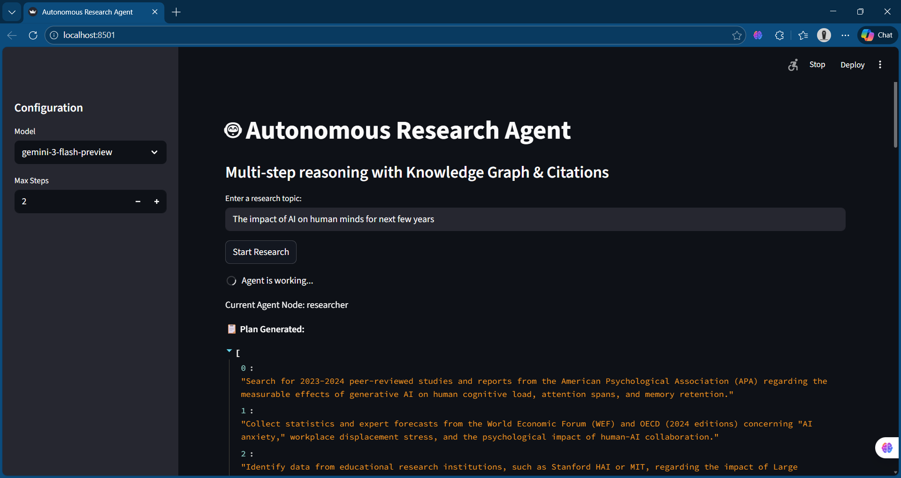
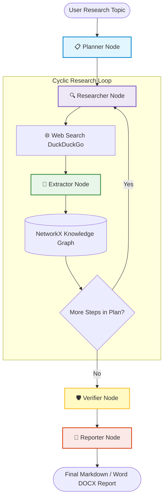

<div align="center">

# 🤖 Autonomous Research Agent
### *Deep Research with Multi-Step Reasoning & Knowledge Graphs*

[](https://python.org)
[](https://streamlit.io)
[](https://langchain.com)
[](LICENSE)

[**Architecture**](#-architecture--workflow) • [**Quick Start (Windows)**](#-quick-start-windows-1-click) • [**Manual Setup**](#%EF%B8%8F-manual-setup) • [**Supported Models**](#-supported-models) • [**Monitoring**](#-monitoring--metrics) • [**Project Structure**](#-project-structure)



</div>

---

## 🚀 Overview

The **Autonomous Research Agent** is a deep research engine built to plan, execute, synthesize, and verify multi-step investigations into complex topics. Instead of relying on single-pass prompting, the system uses a **LangGraph cyclic state machine** to decompose inquiries into focused search goals, extract factual knowledge graph triplets, cross-validate findings against source logs to eliminate hallucinations, and produce publication-ready reports.

### ✨ Key Features

- **LangGraph Cyclic State Machine**: Five specialized nodes orchestrating the full research lifecycle:
  - **📋 Planner Node**: Decomposes high-level topics into 2–3 actionable, temporally scoped research objectives.
  - **🔍 Researcher Node**: Conducts iterative web queries using DuckDuckGo search and extracts live snippets.
  - **🧠 Extractor Node**: Mines structured knowledge triplets (`subject`, `predicate`, `object`) to uncover entity relations.
  - **🛡️ Verifier Node**: Cross-references findings against raw search logs, flags unsupported claims, and assigns a credibility score (0–10).
  - **📝 Reporter Node**: Synthesizes verified data into a structured report adhering to a zero-hallucination policy and citing sources.
- **🕸️ Dynamic Knowledge Graph Visualization**: Constructs an in-memory graph using **NetworkX** and renders entity relationships in real time with **Matplotlib**.
- **📄 Dual Export Formats**: Export final research artifacts directly as Markdown (`.md`) or structured Microsoft Word documents (`.docx`).
- **📊 Real-Time Prometheus Metrics**: Embedded Prometheus metrics server on port `8000` reporting query counts, token estimations, and latency.
- **🎨 Interactive Streamlit Interface**: Responsive UI providing step-by-step visibility into agent reasoning, intermediate search results, and knowledge graphs.

---

## 🏗️ Architecture & Workflow

The agent operates as a cyclical state machine compiled via **LangGraph**:



### Agent State Lifecycle
1. **Planning**: `planner` analyzes the user task and outputs discrete research steps.
2. **Iteration**: `researcher` searches DuckDuckGo for the active step; `extractor` parses facts into entity-relation triplets (`subject`, `predicate`, `object`) stored in state.
3. **Loop Control**: `should_continue` checks if remaining plan steps exist. If yes, it routes back to `researcher`; if all steps are complete, it proceeds to verification.
4. **Fact-Checking**: `verifier` audits collected findings against raw search logs for contradictions and unsupported claims, assigning a credibility score.
5. **Synthesis**: `reporter` writes the final report formatted with Executive Summary, Key Findings, Detailed Analysis, and References.

---

## ⚡ Quick Start (Windows 1-Click)

The repository provides automated startup batch scripts (`run.bat` and `start_project.bat`) with built-in sanity checks:

```cmd
# Run directly from Command Prompt, PowerShell, or double-click in File Explorer:
run.bat
```
*(Alternatively, `start_project.bat` proxies directly into `run.bat`)*

### What the 1-Click Launcher Does:
1. **Environment Validation**: Checks for an existing virtual environment at `venv\Scripts\activate.bat`. If missing, alerts the user with setup instructions.
2. **API Key Verification**: Validates presence of `.env` in the project root and reminds the user to configure `GOOGLE_API_KEY`.
3. **Environment Activation**: Activates the local virtual environment cleanly.
4. **Dependency Check**: Verifies that Streamlit is installed and callable in the environment.
5. **Dashboard Launch**: Starts `streamlit run app.py` on `http://localhost:8501`.
6. **Error Trapping**: Catches non-zero exit codes and pauses the terminal window so error outputs can be inspected without the window closing automatically.

---

## 🛠️ Manual Setup

If you prefer to configure and run the project manually or are working across platforms:

### 1. Prerequisites
- **Python 3.11+**
- Google Gemini API Key ([Google AI Studio](https://aistudio.google.com/))

### 2. Clone and Setup Environment

```bash
# Clone the repository
git clone https://github.com/luckyramguguloth/Autonomous-Research-Agent.git
cd Autonomous-Research-Agent

# Create a virtual environment
python -m venv venv

# Activate the virtual environment
# Windows (PowerShell):
.\venv\Scripts\Activate.ps1
# Windows (CMD):
venv\Scripts\activate.bat
# Linux/macOS:
source venv/bin/activate
```

### 3. Install Dependencies

```bash
pip install -r requirements.txt
```

### 4. Configure Environment Variables

Create a `.env` file in the root directory:

```env
# Required: Google Gemini API Key
GOOGLE_API_KEY="your_google_gemini_api_key_here"

# Optional: Tavily API Key (for alternative search providers)
TAVILY_API_KEY="your_tavily_api_key_here"
```

### 5. Run Tests

Verify installation integrity and workflow loading using pytest:

```bash
python -m pytest -v
```

### 6. Launch the Streamlit Dashboard

```bash
streamlit run app.py
```

Open your browser at `http://localhost:8501`.

---

## 🤖 Supported Models

The system integrates with Google Gemini models via `langchain-google-genai` with deterministic temperature settings (`temperature=0`):

| Model | Setting | Characteristics |
|---|---|---|
| **`gemini-3-flash-preview`** *(Default)* | UI Sidebar Selectable | Advanced multimodal reasoning, fast inference, optimal for query decomposition and triplet extraction. |
| **`gemini-2.5-flash`** | UI Sidebar Selectable | Efficient, robust model for rapid search iteration and report synthesis. |

You can switch models on the fly in the Streamlit configuration sidebar before initiating a research run.

---

## 📊 Monitoring & Metrics

The agent includes a background Prometheus metrics server initialized automatically on port **`8000`** (`http://localhost:8000`):

| Metric Name | Type | Description |
|---|---|---|
| `research_agent_search_queries_total` | Counter | Total number of web search queries executed. |
| `research_agent_llm_tokens_total` | Counter | Estimated token volume utilized across LLM invocations. |
| `research_agent_request_latency_seconds` | Histogram | Request latency distribution across agent tasks. |

---

## 🔍 Component Breakdown

| Component | Technology | Role |
|---|---|---|
| **Agent Orchestration** | LangGraph | State machine managing cyclic planning, tool calls, and transitions |
| **Foundation Models** | Google Gemini (`gemini-3-flash-preview`, `gemini-2.5-flash`) | Structured reasoning, schema extraction, validation, reporting |
| **Web Retrieval** | DuckDuckGo Search (`duckduckgo-search` / `ddgs`) | Real-time information gathering |
| **Content Scraping** | Trafilatura & BeautifulSoup4 | Text extraction from web pages |
| **Knowledge Graph** | NetworkX & Matplotlib | Triplet storage, relationship mapping, and in-app graph visualization |
| **Document Export** | `python-docx` & Markdown | Dual-format export of completed research dossiers |
| **Application UI** | Streamlit | Real-time progress monitoring, logs, and graph display |
| **Observability** | Prometheus Client | Operational metrics exported on port 8000 |

---

## 📦 Project Structure

```bash
📦 Autonomous Research Agent
 ┣ 📂 Assets                  # UI previews and documentation media
 ┃ ┗ 📜 interface_preview.png # Application UI screenshot
 ┣ 📂 src
 ┃ ┣ 📂 agent                 # Core LangGraph state machine & nodes
 ┃ ┃ ┣ 📜 __init__.py
 ┃ ┃ ┣ 📜 extractor.py        # Knowledge triplet extraction node
 ┃ ┃ ┣ 📜 planner.py          # Query decomposition & planning node
 ┃ ┃ ┣ 📜 reporter.py         # Final report synthesis node
 ┃ ┃ ┣ 📜 researcher.py       # Search execution node
 ┃ ┃ ┣ 📜 state.py            # TypedDict AgentState definition
 ┃ ┃ ┣ 📜 verifier.py         # Fact-checking & anti-hallucination node
 ┃ ┃ ┗ 📜 workflow.py         # LangGraph StateGraph & conditional routing
 ┃ ┣ 📂 graph                 # Knowledge graph management
 ┃ ┃ ┣ 📜 __init__.py
 ┃ ┃ ┗ 📜 manager.py          # NetworkX graph manager
 ┃ ┣ 📂 tools                 # Agent tool definitions
 ┃ ┃ ┣ 📜 __init__.py
 ┃ ┃ ┣ 📜 scraper.py          # Trafilatura & BS4 web scrapers
 ┃ ┃ ┗ 📜 search.py           # DuckDuckGo search integration
 ┃ ┗ 📂 utils                 # Utility modules
 ┃   ┣ 📜 __init__.py
 ┃   ┣ 📜 metrics.py          # Prometheus metrics & server configuration
 ┃   ┗ 📜 word_generator.py   # Word (.docx) document generator
 ┣ 📂 tests                   # Test suite
 ┃ ┣ 📜 conftest.py           # Pytest fixtures and environment mocks
 ┃ ┗ 📜 test_agent.py         # State, graph, and workflow unit tests
 ┣ 📜 .env                    # Environment credentials (API keys)
 ┣ 📜 .gitignore              # Git ignore rules
 ┣ 📜 app.py                  # Streamlit frontend entry point
 ┣ 📜 BLOG_POST.md            # Technical design and architecture deep-dive
 ┣ 📜 README.md               # Project documentation
 ┣ 📜 requirements.txt        # Python package dependencies
 ┣ 📜 run.bat                 # Windows 1-click launcher with error trapping
 ┗ 📜 start_project.bat       # Convenience shortcut for run.bat
```

---

## 📄 License

This project is licensed under the [MIT License](LICENSE).
